# Docker 101

A practical introduction to Docker: what it is, why it exists, how it works under the hood, and the everyday commands you need to get productive.

---

## Table of Contents

1. [Why do we need Docker?](#why-do-we-need-docker)
2. [How does Docker work?](#how-does-docker-work)
3. [Docker architecture](#docker-architecture)
4. [Images vs Containers](#images-vs-containers)
5. [Installing Docker](#installing-docker)
6. [Essential Docker commands](#essential-docker-commands)
7. [Image tags](#image-tags)
8. [Port mapping](#port-mapping)
9. [Volumes and bind mounts](#volumes-and-bind-mounts)
10. [Inspecting containers and reading logs](#inspecting-containers-and-reading-logs)
11. [Building your own image (Dockerfile)](#building-your-own-image-dockerfile)
12. [Image layers](#image-layers)
13. [BuildKit: faster and safer builds](#buildkit-faster-and-safer-builds)
14. [docker init](#docker-init)

---

## Why do we need Docker?

A typical application is made of several moving parts — a **frontend**, a **backend**, and a **database**. Each of these often needs its own runtime, library versions, and setup steps. Installing and maintaining all of that by hand on every developer laptop, test server, and production machine quickly leads to the classic problem:

> *"It works on my machine."*

Docker solves this by packaging an application **together with everything it needs to run** — a minimal OS userland, libraries, dependencies, configuration, and the start-up command — into a single portable unit. The only thing a machine needs is Docker itself. The same package then runs identically everywhere.

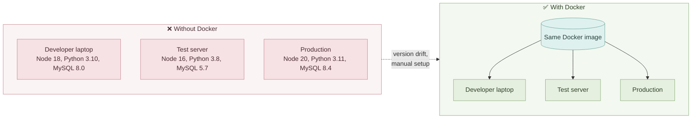

**Key benefits**

- **Consistency** — identical environment from development to production.
- **Isolation** — each app runs in its own container with its own dependencies; no conflicts.
- **Speed** — containers start in seconds, far faster than virtual machines.
- **Portability** — run anywhere Docker is installed: laptop, on-prem server, or cloud.

---

## How does Docker work?

Unlike a virtual machine, a container does **not** bundle a full operating system with its own kernel. Instead, all containers on a host **share the host's OS kernel**, and each container only brings its own userland (filesystem, libraries, binaries).

This has two important consequences:

- On a **Linux** host, you can run containers based on any Linux distribution — Ubuntu, Fedora, Alpine, Debian, etc. — because they all use the Linux kernel.
- You **cannot** run a Windows container on a Linux kernel (and vice versa), because the kernel is different.

> **Note:** On macOS and Windows, Docker Desktop quietly runs a lightweight Linux VM in the background so that Linux containers can still share a Linux kernel.

### Containers vs Virtual Machines

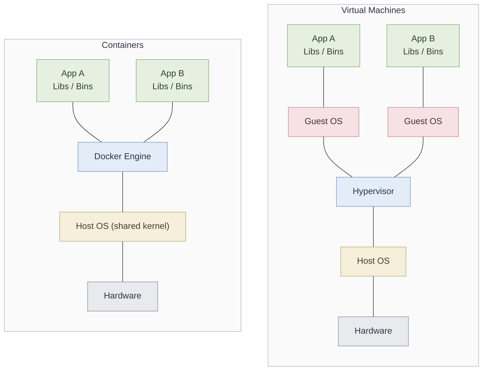

| | Virtual Machine | Container |
|---|---|---|
| Includes a full guest OS | Yes | No — shares host kernel |
| Typical size | Gigabytes | Megabytes |
| Start-up time | Minutes | Seconds |
| Isolation level | Strong (hardware-level) | Process-level |

---

## Docker architecture

Docker follows a **client–server** model:

- **Docker Client (CLI)** — the `docker` command you type. It sends requests to the daemon.
- **Docker Daemon (`dockerd`)** — the background service that actually builds images, runs containers, and manages networks and volumes.
- **Registry** — a remote store for images (e.g. Docker Hub, GitHub Container Registry, AWS ECR).

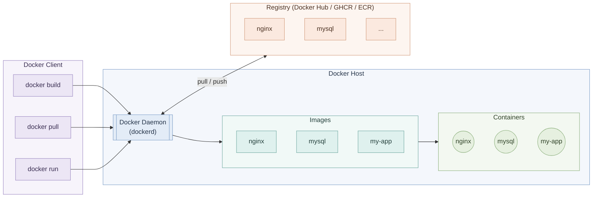

### The layered stack

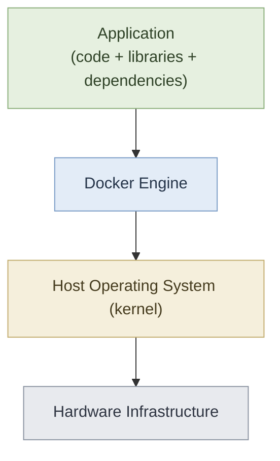

---

## Images vs Containers

| | Image | Container |
|---|---|---|
| What it is | A **read-only template** containing the app, its dependencies, and configuration | A **running (or stopped) instance** of an image |
| Analogy | A class / a recipe | An object / the cooked dish |
| Mutable? | No | Yes — has a thin writable layer on top |
| Created by | `docker build` or `docker pull` | `docker run` |

One image can be used to start **many** containers:

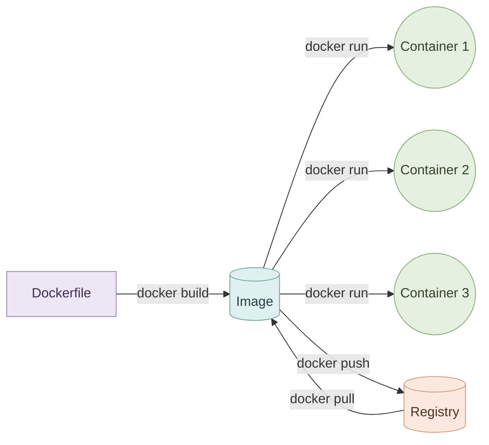

---

## Installing Docker

Follow the official guide for your platform: **[https://docs.docker.com/engine/install/](https://docs.docker.com/engine/install/)**

Quick install on most Linux distributions (official convenience script):

```bash
curl -fsSL https://get.docker.com -o get-docker.sh
sudo sh get-docker.sh
```

Allow your user to run Docker without `sudo` (log out and back in afterwards):

```bash
sudo usermod -aG docker $USER
```

Verify the installation:

```bash
docker --version
docker run hello-world
```

### 🛠️ Planned: automated install script

A helper script will be added to this repository to make installation one step. It will:

1. Detect the operating system and distribution.
2. Detect the CPU architecture (`x86_64`, `arm64`, …).
3. Install the matching Docker version.
4. Verify that the Docker service is running.
5. Print a short list of commands to get started.

---

## Essential Docker commands

Replace values in `<angle brackets>` with your own.

### Run containers

Run a container in the foreground:

```bash
docker run nginx
```

Run a container in the background (detached) with a friendly name:

```bash
docker run -d --name my-nginx nginx
```

Run a container and open an interactive shell inside it:

```bash
docker run -it ubuntu bash
```

### List images and containers

List images stored locally:

```bash
docker images
```

List running containers:

```bash
docker ps
```

List all containers, including stopped ones:

```bash
docker ps -a
```

### Download images

```bash
docker pull nginx:1.27
```

### Interact with a running container

Run a command inside a running container (e.g. open a shell):

```bash
docker exec -it <container> sh
```

Attach your terminal to the container's main process:

```bash
docker attach <container>
```

### Stop and remove

Stop a running container:

```bash
docker stop <container>
```

Remove a stopped container:

```bash
docker rm <container>
```

Remove an image (no container may be using it):

```bash
docker rmi <image>
```

Clean up all stopped containers, unused networks, dangling images, and build cache:

```bash
docker system prune
```

### Quick reference

| Command | Purpose |
|---|---|
| `docker run` | Create and start a container |
| `docker run -d` | Run in the background (detached) |
| `docker images` | List local images |
| `docker ps` / `docker ps -a` | List running / all containers |
| `docker pull` | Download an image from a registry |
| `docker exec` | Run a command inside a running container |
| `docker attach` | Attach to a container's main process |
| `docker stop` | Stop a running container |
| `docker rm` | Remove a container |
| `docker rmi` | Remove an image |
| `docker inspect` | Show detailed configuration (JSON) |
| `docker logs` | Show container output |
| `docker history` | Show the layers an image is built from |
| `docker system prune` | Remove unused data |

### Container lifecycle

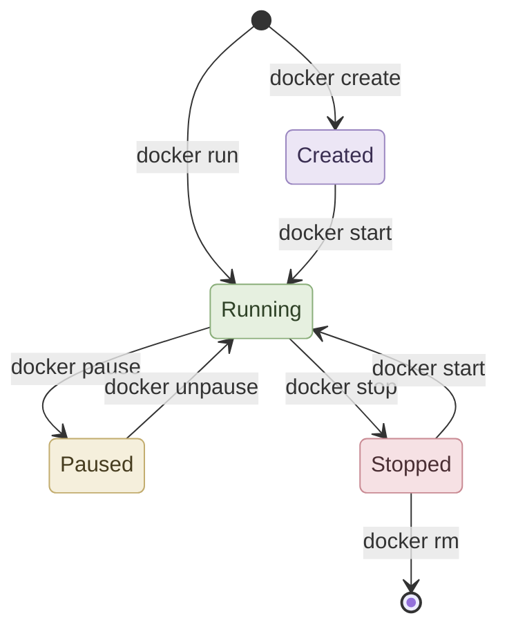

---

## Image tags

A **tag** identifies a specific version of an image, written as `image:tag`. If you omit the tag, Docker uses `latest`.

Pull the `latest` tag (implicit):

```bash
docker pull mysql
```

Pull a specific, pinned version:

```bash
docker pull mysql:8.4
```

> ⚠️ **Avoid `latest` in production.** `latest` is convenient for experiments, but it is a moving target — the next time you redeploy, Docker may pull a newer version containing breaking changes. Always pin an explicit version tag in production so deployments are predictable and reproducible.

---

## Port mapping

Containers run on an isolated network. To reach an application inside a container from your machine (or the outside world), you **publish** a container port to a host port with `-p <host_port>:<container_port>`.

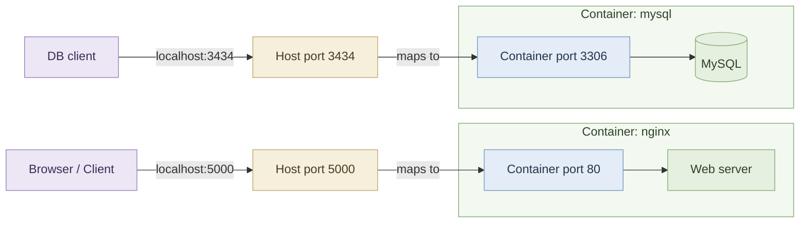

Expose a web server running on port `80` inside the container at port `5000` on the host:

```bash
docker run -d -p 5000:80 nginx
```

Expose a MySQL database running on port `3306` inside the container at port `3434` on the host:

```bash
docker run -d -p 3434:3306 -e MYSQL_ROOT_PASSWORD=secret mysql:8.4
```

> **Note:** A host port can only be used by **one** container at a time. To run two web servers, map them to different host ports (e.g. `5000:80` and `5001:80`). The *container* ports can be the same, because each container has its own isolated network.

---

## Volumes and bind mounts

A container's filesystem is **ephemeral**: anything written inside it is lost when the container is removed. For data that must survive — databases, uploads, logs — store it **outside** the container and mount it in.

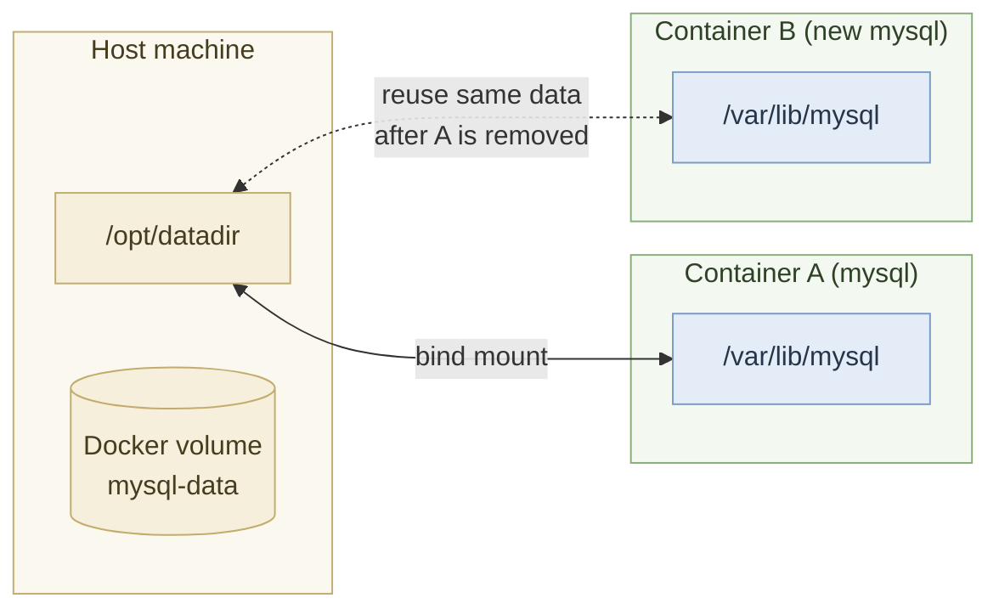

There are two main ways to persist data:

| Type | Where the data lives | Best for |
|---|---|---|
| **Bind mount** | A specific path you choose on the host | Local development, sharing source code or config |
| **Named volume** | Managed by Docker (`/var/lib/docker/volumes/...`) | Databases and production data |

### Using `-v` (short syntax)

Separate the host path and container path with a colon (`:`):

```bash
docker run -d -v /opt/datadir:/var/lib/mysql -e MYSQL_ROOT_PASSWORD=secret mysql:8.4
```

### Using `--mount` (explicit syntax)

More verbose but clearer — each option is named:

```bash
docker run -d --mount type=bind,source=/opt/datadir,target=/var/lib/mysql -e MYSQL_ROOT_PASSWORD=secret mysql:8.4
```

### Using a named volume

Create a volume managed by Docker:

```bash
docker volume create mysql-data
```

Mount it into a container:

```bash
docker run -d -v mysql-data:/var/lib/mysql -e MYSQL_ROOT_PASSWORD=secret mysql:8.4
```

Because the data lives outside the container, you can remove the container and start a new one pointing at the same path or volume — your data is still there.

---

## Inspecting containers and reading logs

View the full configuration of a container (network, mounts, environment variables, state) as JSON:

```bash
docker inspect <container>
```

View a container's output (stdout/stderr):

```bash
docker logs <container>
```

Follow the logs live, like `tail -f`:

```bash
docker logs -f <container>
```

Show only the last 100 lines:

```bash
docker logs --tail 100 <container>
```

---

## Building your own image (Dockerfile)

Docker Hub ([https://hub.docker.com](https://hub.docker.com)) has ready-made images for most popular software. When no suitable image exists for your application, you build your own using a **Dockerfile** — a plain text file containing step-by-step instructions.

### Common Dockerfile instructions

| Instruction | Purpose |
|---|---|
| `FROM` | Sets the base image (an OS like `ubuntu`, or a runtime like `python:3.12-slim`). **Every Dockerfile must start with `FROM`.** |
| `WORKDIR` | Sets the working directory for subsequent instructions. |
| `RUN` | Executes a command at build time (e.g. install packages). |
| `COPY` | Copies files from your machine (the build context) into the image. |
| `ENV` | Sets environment variables available inside the container. |
| `EXPOSE` | Documents which port the application listens on. |
| `ENTRYPOINT` / `CMD` | The command that runs when a container starts from the image. |

### Example Dockerfile

```dockerfile
# 1. Base image
FROM python:3.12-slim

# 2. Working directory inside the image
WORKDIR /app

# 3. Install dependencies first (better layer caching)
COPY requirements.txt .
RUN pip install --no-cache-dir -r requirements.txt

# 4. Copy the application source code
COPY . .

# 5. Environment variables
ENV APP_ENV=production

# 6. Port the app listens on
EXPOSE 8000

# 7. Command to run when the container starts
ENTRYPOINT ["python", "app.py"]
```

### Build → Run → Push workflow

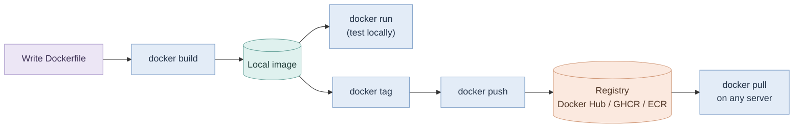

Build the image from the Dockerfile in the current directory and give it a name and tag:

```bash
docker build -t my-app:1.0 .
```

Run it locally to test:

```bash
docker run -d -p 8000:8000 my-app:1.0
```

Log in to your registry (Docker Hub shown here):

```bash
docker login
```

Tag the image with your registry username/repository:

```bash
docker tag my-app:1.0 <your-username>/my-app:1.0
```

Push it to the registry:

```bash
docker push <your-username>/my-app:1.0
```

Anyone with access can now pull and run the exact same image on any machine with Docker installed.

---

## Image layers

A Docker image is not one big blob — it is a **stack of read-only layers**. Each instruction in the Dockerfile adds a new layer on top of the previous one (`RUN`, `COPY` and `ADD` add files; instructions like `ENV`, `EXPOSE` and `ENTRYPOINT` add metadata only). When you start a container, Docker places a thin **writable layer** on top; everything the running container changes lives there, and the image layers underneath stay untouched.

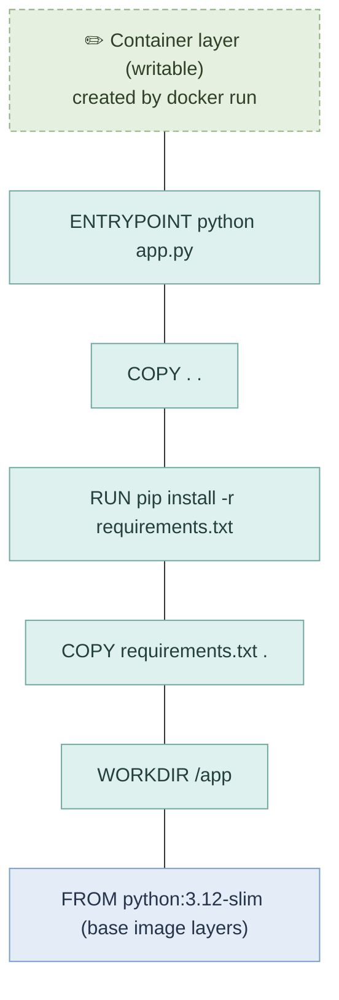

**Why layers matter**

- **Caching** — Docker reuses unchanged layers on rebuild. As soon as one layer changes, that layer and **every layer after it** are rebuilt. This is why the example copies `requirements.txt` and installs dependencies *before* copying the source code: editing your code doesn't force a full reinstall of every package.
- **Sharing** — images built on the same base image share those base layers on disk and when pulling, saving space and bandwidth.
- **Size** — every layer adds to the image size, so combine related commands (e.g. `apt-get update && apt-get install -y ...`) and clean up within the same `RUN`.

See the layers an image is made of, with the instruction and size of each:

```bash
docker history my-app:1.0
```

> 💡 **Pro tip (my own practice):** Before building an image and pushing it to a registry such as ECR, run the Dockerfile's commands by hand, one at a time, inside a container started from the same base image. This shows you exactly what each layer does, and you catch missing packages, wrong paths and permission errors early — before a slow build-and-push cycle.
>
> Start a throwaway container from the base image with your project folder mounted:
>
> ```bash
> docker run -it --rm -v "$PWD":/app -w /app python:3.12-slim bash
> ```
>
> Then, inside the container, run each `RUN` step from your Dockerfile in order and check the result before moving on:
>
> ```bash
> pip install --no-cache-dir -r requirements.txt
> python app.py
> ```
>
> Once every step works by hand, put them into the Dockerfile and build with confidence.

---

## BuildKit: faster and safer builds

### Problems with the classic builder

The classic `docker build` engine works, but it has four pain points once your images get real:

1. **Packages re-download on every build** — change a single line of code (or a dependency file) and the layer that installs packages is invalidated, so `pip install` / `npm install` / `apt-get install` downloads everything again from scratch. Rebuilds are slow even for tiny changes.
2. **Secrets leak into the image** — credentials passed with `--build-arg` and used in a `RUN` step are recorded in plain text in the image history (`docker history` shows them). Putting them in `ENV` is no better: the value is baked into the image config and visible with `docker inspect`. Anyone who pulls the image can read them.
3. **One image per CPU architecture** — an image built on an `amd64` laptop won't run natively on an `arm64` server (AWS Graviton, Raspberry Pi, Apple Silicon). You end up building and tagging a separate image for each platform.
4. **Stages build one after another** — in a multi-stage Dockerfile, the classic builder runs every stage sequentially, even when the stages don't depend on each other, and it builds stages that the final image never uses.

### What BuildKit fixes

**BuildKit** is Docker's modern build engine and the default builder since Docker Engine 23.0. `docker buildx build` is its full-featured command (`docker build` also uses BuildKit by default). Each problem above has a matching feature:

| Problem | BuildKit feature | How it helps |
|---|---|---|
| Packages re-download every build | **Cache mount** | Keeps the package manager's download cache on the build host between builds |
| Secrets leak into image | **Secret mount** | Exposes the secret only while a single `RUN` step executes — never written to a layer or the history |
| One image per architecture | **Multi-platform build** | Builds several architectures in one command and publishes them under one tag |
| Stages build sequentially | **Parallel stages** | Builds independent stages at the same time and skips stages the target doesn't need |

Start the Dockerfile with this line to use the latest stable Dockerfile syntax, which includes all the `--mount` features below:

```dockerfile
# syntax=docker/dockerfile:1
```

### Cache mount

A cache mount stores a directory (such as pip's download cache) on the build host, outside the image. On the next build, even if the layer has to re-run, the package manager finds the files already downloaded and only fetches what changed.

```dockerfile
# syntax=docker/dockerfile:1
FROM python:3.12-slim
WORKDIR /app
COPY requirements.txt .
RUN --mount=type=cache,target=/root/.cache/pip \
    pip install -r requirements.txt
COPY . .
ENTRYPOINT ["python", "app.py"]
```

Build it with BuildKit:

```bash
docker buildx build -t my-app:1.0 .
```

> **Note:** The cache lives in the builder, not in the image, so it doesn't make the image bigger. That is also why `--no-cache-dir` is dropped here — we *want* pip to keep its cache.

### Secret mount

A secret mount makes a file available at `/run/secrets/<id>` only for the duration of one `RUN` step. Once that step finishes the secret is gone: it isn't in any layer, and `docker history` shows nothing.

```dockerfile
# syntax=docker/dockerfile:1
FROM python:3.12-slim
WORKDIR /app
COPY requirements.txt .
RUN --mount=type=secret,id=pip_token \
    PIP_INDEX_URL="https://user:$(cat /run/secrets/pip_token)@pypi.example.com/simple" \
    pip install -r requirements.txt
```

Pass the secret from a file on your machine at build time:

```bash
docker buildx build --secret id=pip_token,src=./pip_token.txt -t my-app:1.0 .
```

Confirm nothing leaked:

```bash
docker history my-app:1.0
```

> **Note:** Secret mounts are for **build-time** secrets (private package registries, git tokens). Secrets the application needs at **runtime** should be passed when the container starts (e.g. `-e`, an env file, or your platform's secret manager), never baked into the image.

### Multi-platform build

Build for several CPU architectures in one command. The result is a single tag that points to one image per platform; when someone runs `docker pull` or `docker run`, Docker automatically picks the variant matching their machine.

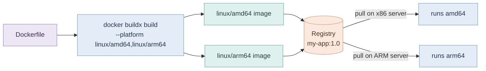

```bash
docker buildx build --platform linux/amd64,linux/arm64 -t <your-username>/my-app:1.0 --push .
```

> **Note:** `--push` sends the result straight to the registry, because the classic local image store can only hold one platform per tag. Building for a non-native architecture uses QEMU emulation, which Docker Desktop sets up for you; on a plain Linux engine you may need to create a builder first with `docker buildx create --use`.

### Parallel stages

BuildKit reads the whole Dockerfile as a dependency graph. Stages that don't depend on each other are built **at the same time**, and stages the final target never uses are **skipped entirely** — no extra configuration needed.

```dockerfile
# syntax=docker/dockerfile:1
FROM node:22-slim AS frontend
WORKDIR /web
COPY web/ .
RUN npm ci && npm run build

FROM python:3.12-slim AS backend
WORKDIR /app
COPY requirements.txt .
RUN pip install --no-cache-dir -r requirements.txt

FROM python:3.12-slim
WORKDIR /app
COPY --from=backend /usr/local/lib/python3.12/site-packages /usr/local/lib/python3.12/site-packages
COPY --from=frontend /web/dist ./static
COPY . .
ENTRYPOINT ["python", "app.py"]
```

Here `frontend` and `backend` build in parallel; the final stage starts once both are done.

---

## docker init

Writing a Dockerfile by hand is hard when you don't yet know the best practices — which base image is small enough, how to structure a multi-stage build, or how to run as a non-root user. `docker init` helps: it asks a few questions about your project and generates the starter files for you.

```bash
docker init
```

It asks for things like the application platform (Python, Node, Go, Java, Rust, PHP, ASP.NET…), the runtime version, the port the app listens on and the command that starts it. It then creates:

| File | Purpose |
|---|---|
| `Dockerfile` | A multi-stage Dockerfile following current best practices |
| `.dockerignore` | Keeps unneeded files (e.g. `.git`, virtualenvs) out of the build context |
| `compose.yaml` | A Docker Compose file to run the app with `docker compose up` |
| `README.Docker.md` | Short instructions for building and running the generated setup |

> **Note:** `docker init` is **not an AI tool** — it fills in fixed templates from your answers. It won't produce a perfect Dockerfile for every project, so review the generated files and adjust them to your needs. Its value is cutting out the boilerplate and giving you a solid, best-practice starting point. It ships with Docker Desktop.


Command vs Entrypoint

